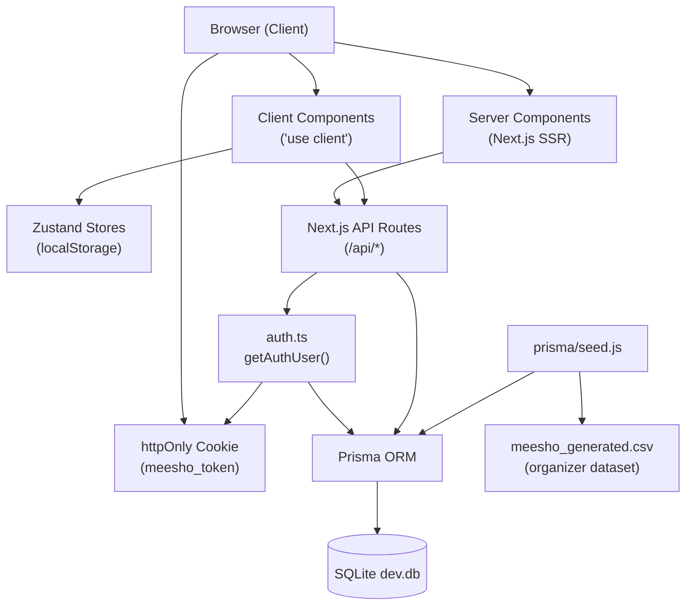
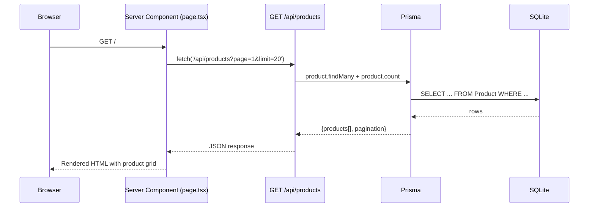
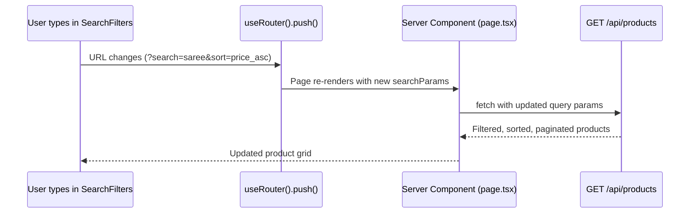
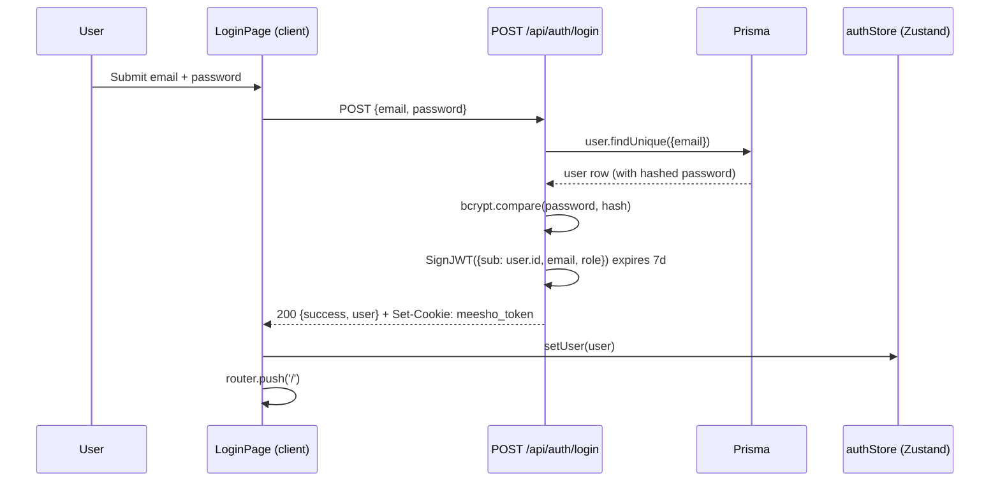
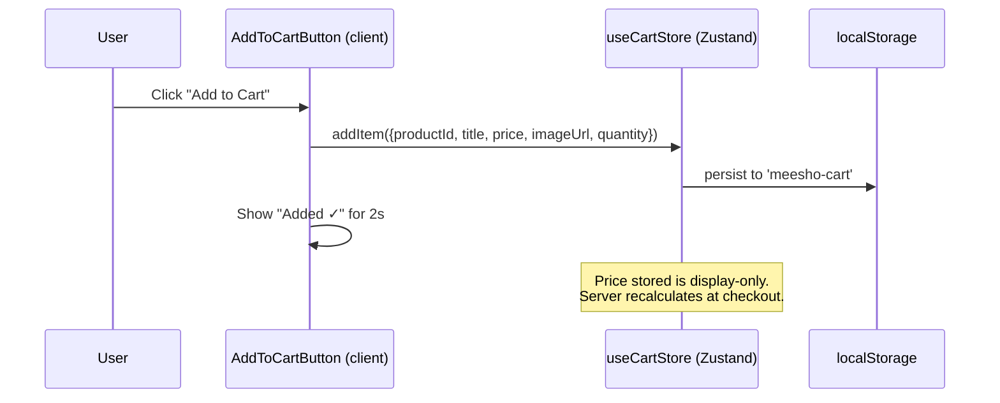
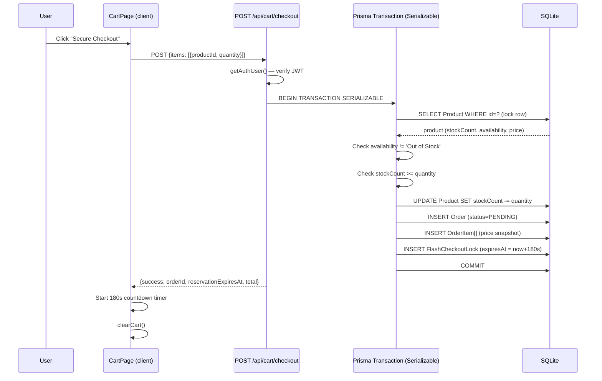
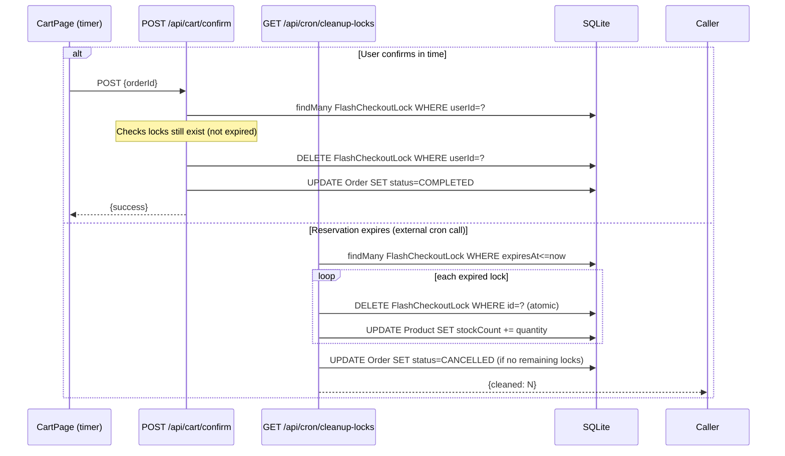
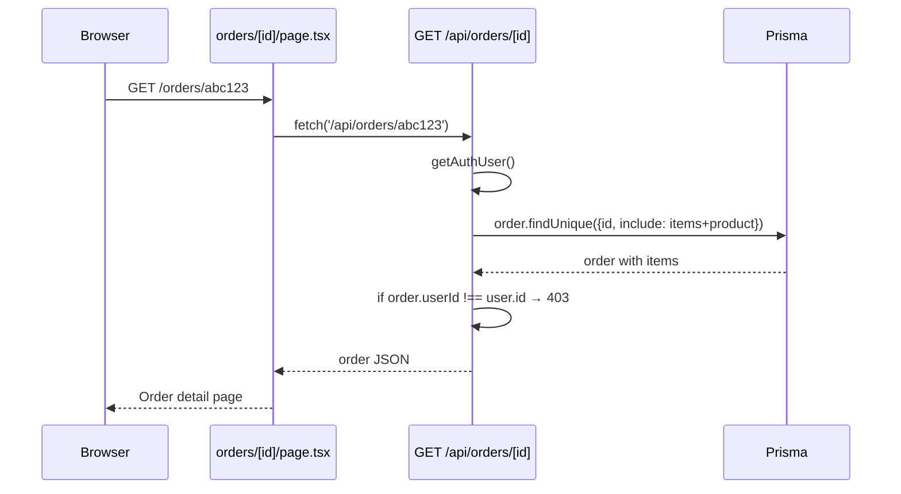

# Architecture — Meesho E-Commerce Platform

> This document describes the **verified** system architecture of the Meesho hackathon platform as it exists in the repository. Claims are derived from source code inspection, not assumptions.

---

## 1. High-Level Architecture



### Execution contexts

| Where | What runs there |
|---|---|
| **Browser only** | `useCartStore`, `useAuthStore`, `useThemeStore`, `useNetworkStore` (Zustand). Event handlers, timer effects, form submissions. |
| **Server only** | All `src/app/api/*` route handlers. `getAuthUser()`. Prisma queries. `prisma/seed.js`. |
| **Both (hydrated)** | Server Components (`page.tsx`, `layout.tsx`) render on server first, then hydrate on client. |

---

## 2. Request-Flow Diagrams

### A. Loading the product catalogue



### B. Searching and filtering



### C. Login and session



### D. Adding to cart



### E. Flash checkout reservation



### F. Confirming or expiring the reservation



### G. Viewing an order



---

## 3. Component & File Reference

### Pages

| File | Runs on | Responsibility | Calls |
|---|---|---|---|
| `src/app/layout.tsx` | Server + Client | Root HTML shell, Navbar, theme init script | `Navbar` |
| `src/app/page.tsx` | Server | Homepage — fetches products, renders grid | `/api/products`, `SearchFilters`, `ProductCard` |
| `src/app/product/[id]/page.tsx` | Server | Product detail — two-column layout | `/api/products/[id]`, `AddToCartButton`, `PriceHistoryChart` |
| `src/app/cart/page.tsx` | Client | Cart display, checkout trigger, countdown timer | `/api/cart/checkout`, `useCartStore` |
| `src/app/orders/page.tsx` | Server | Order history list | `/api/orders` |
| `src/app/orders/[id]/page.tsx` | Server | Order detail | `/api/orders/[id]` |
| `src/app/auth/login/page.tsx` | Client | Login form | `/api/auth/login`, `useAuthStore` |
| `src/app/auth/register/page.tsx` | Client | Registration form | `/api/auth/register` |

### Shared Components

| File | Responsibility | Owner |
|---|---|---|
| `Navbar.tsx` | Navigation, theme toggle, search, auth state display/logout | Member 1 (Integration Lead) |
| `SearchFilters.tsx` | Search input, category/sort/price filters, URL-param updates | Member 2 (Product Discovery) |
| `ProductCard.tsx` | Product tile — image, price, Add to Cart hover action | Member 2 |
| `ProductSkeleton.tsx` | Dark skeleton loaders for loading states | Member 5 (QA) |
| `AddToCartButton.tsx` | Add-to-Cart with visual feedback; disabled for Out of Stock | Member 3 (Shopping Journey) |
| `PriceHistoryChart.tsx` | Recharts line chart for price history | Member 3 |

### API Routes

| File | HTTP | Purpose | Auth |
|---|---|---|---|
| `api/auth/register/route.ts` | POST | Hash password, create user | No |
| `api/auth/login/route.ts` | POST | Verify password, issue JWT cookie | No |
| `api/auth/logout/route.ts` | POST | Clear JWT cookie | No |
| `api/auth/me/route.ts` | GET | Return current user from token | Cookie |
| `api/products/route.ts` | GET | Paginated, filtered, sorted product list | No |
| `api/products/[id]/route.ts` | GET | Single product with price history | No |
| `api/cart/checkout/route.ts` | POST | Serializable transaction: reserve stock, create order | Cookie |
| `api/cart/confirm/route.ts` | POST | Complete order, delete locks | Cookie |
| `api/cron/cleanup-locks/route.ts` | GET | Restore expired inventory, cancel orders | Bearer |
| `api/orders/route.ts` | GET | User's order history | Cookie |
| `api/orders/[id]/route.ts` | GET | Single order (ownership enforced) | Cookie |

### Libraries

| File | Responsibility |
|---|---|
| `src/lib/auth.ts` | `getAuthUser()` — reads cookie, verifies JWT, fetches user from DB |
| `src/lib/prisma.ts` | Singleton Prisma client (prevents connection exhaustion in dev) |
| `src/lib/utils.ts` | `cn()` — Tailwind class merger |

### Stores (Zustand)

| File | Persisted key | Data |
|---|---|---|
| `store/store.ts` → `useCartStore` | `meesho-cart` | Cart items array |
| `store/store.ts` → `useNetworkStore` | `meesho-network` | `liteMode` boolean |
| `store/authStore.ts` → `useAuthStore` | `meesho-auth` | `{id, name, email, role}` or null |
| `store/themeStore.ts` → `useThemeStore` | `theme` | `'light'` or `'dark'` |

---

## 4. Database Schema

```
User
  id        UUID PK
  name      String
  email     String UNIQUE
  password  String (bcrypt hash)
  role      String ('user' | 'admin')
  createdAt DateTime
  updatedAt DateTime
  └── orders Order[]

Product
  id                 UUID PK
  productId          String UNIQUE  ← CSV product_id (e.g. MEESHO_1000000)
  title, category, subcategory, brand
  originalPrice, discountedPrice, discountPercentage
  rating, reviewCount
  availability       String ('In Stock' | 'Out of Stock' | 'Limited Stock')
  stockCount         Int  ← SYNTHETIC (5-50, never in CSV, never overwritten on re-import)
  sellerName, imageUrl, productUrl, description
  colorsAvailable, sizesAvailable, material
  codAvailable       Boolean
  returnPolicy, deliveryTime
  @@index([category, availability, discountedPrice, rating, title])
  └── orderItems  OrderItem[]
  └── flashLocks  FlashCheckoutLock[]
  └── priceHistory PriceHistory[]

Order
  id            UUID PK
  userId        FK → User
  total         Float  ← server-calculated at checkout time
  status        String ('PENDING' | 'COMPLETED' | 'CANCELLED')
  reservationId String?  ← set to order.id for idempotency
  createdAt     DateTime
  └── items OrderItem[]

OrderItem
  id        UUID PK
  orderId   FK → Order
  productId FK → Product
  quantity  Int
  price     Float  ← snapshot of discountedPrice at checkout (immutable)

FlashCheckoutLock
  id        UUID PK
  productId FK → Product
  userId    String  ← user.id (not a FK — allows orphan cleanup)
  quantity  Int
  lockedAt  DateTime
  expiresAt DateTime  ← now + 180 seconds

PriceHistory
  id         UUID PK
  productId  FK → Product
  price      Float
  recordedAt DateTime
```

### Key relationships

- One `User` has many `Orders`.
- One `Order` has many `OrderItems`. Each `OrderItem` stores a price **snapshot** at the time of checkout. This snapshot is immutable — changing the product price later does not affect existing orders.
- One `Product` has many `FlashCheckoutLocks`. A lock represents reserved units that have not yet been confirmed or expired.
- `stockCount` is **remaining available stock** (i.e., physical stock minus already-decremented reservations). It is decremented at checkout and restored by the cron job on expiry.

---

## 5. Inventory & Concurrency Model

### stockCount semantics

`stockCount` represents the **remaining available units** after accounting for all decrements made during checkout. It does **not** include a separate "reserved" layer — decrement happens immediately inside the Serializable transaction.

### Concurrency safety

The checkout route uses a **Serializable isolation level** Prisma transaction:

```typescript
await prisma.$transaction(async (tx) => { ... }, {
  isolationLevel: 'Serializable',
  maxWait: 5000,
  timeout: 10000
})
```

Within the transaction, each `product.update` with `{ decrement: quantity }` is atomic. Concurrent requests will serialize, so the last unit is not double-sold.

### Expiry and restoration

The cleanup route deletes each lock **before** restoring stock:

```typescript
await prisma.flashCheckoutLock.delete({ where: { id: lock.id } })  // throws P2025 if already deleted
await prisma.product.update({ data: { stockCount: { increment: lock.quantity } } })
```

If two concurrent cleanup calls process the same lock, only the first succeeds at deletion. The second gets `P2025` and skips the stock increment — preventing double-restoration.

### Known limitation: cleanup is not scheduled

The cron endpoint must be called externally (e.g., via a Windows Task Scheduler, a Vercel cron, or a simple timer). There is no built-in scheduler. During the hackathon demo, trigger it manually:

```powershell
Invoke-RestMethod 'http://localhost:3000/api/cron/cleanup-locks' `
  -Headers @{ Authorization = 'Bearer YOUR_CRON_SECRET' }
```

---

## 6. Bharat Lite Mode

When `liteMode` is `true` in `useNetworkStore`:
- `ProductCard` replaces every `` with a dark placeholder showing a shield icon and "Lite Mode" label.
- `CartPage` skips rendering cart item images.
- Network requests for images are not made (the `` element is never rendered).

The mode persists across page refreshes via Zustand's `persist` middleware (`localStorage` key: `meesho-network`).

---

## 7. Theme System

The theme is controlled by adding or removing the `dark` class on `<html>`.

- `globals.css` defines two sets of CSS variables: `:root` (light) and `.dark` (dark).
- `themeStore.ts` (`useThemeStore`) stores the chosen theme in `localStorage` (key: `theme`).
- `layout.tsx` includes an inline `<script>` that reads `localStorage.theme` and applies the class before the page renders — preventing flash of wrong theme.
- All components use Tailwind semantic classes (`bg-background`, `text-foreground`, `bg-card`, etc.) that automatically resolve to the correct CSS variable.

---

## 8. Authentication Flow

1. User submits email + password to `POST /api/auth/login`.
2. Server fetches user by email, runs `bcrypt.compare`.
3. On success, signs a JWT (`jose` `SignJWT`) with `{sub: user.id, email, role}` expiring in 7 days.
4. JWT is set as an `httpOnly`, `SameSite=Lax`, `path=/` cookie named `meesho_token`.
5. Subsequent requests to protected endpoints call `getAuthUser()` which:
   - Reads the cookie server-side (Next.js `cookies()` API).
   - Verifies the JWT signature using `NEXTAUTH_SECRET`.
   - Fetches the user row from DB to confirm the user still exists.
6. On logout, the cookie is cleared server-side.

Passwords are never returned in API responses. JWTs are never stored in `localStorage`.

---

## 9. Security Notes

| Area | Status |
|---|---|
| Password hashing | bcrypt with cost factor 12 |
| JWT in httpOnly cookie | ✅ — not accessible to JavaScript |
| Server-side price calculation | ✅ — client price is display-only |
| Order ownership enforcement | ✅ — 403 if `order.userId !== user.id` |
| Sort field allowlist | ✅ — unsupported sort defaults to `rating_desc` |
| CRON_SECRET required | ✅ — 401 if missing or wrong |
| Input validation | ✅ — quantity, productId, items[] length |
| Stack traces in API responses | ✅ None exposed — generic error messages only |
| NEXTAUTH_SECRET validation | Startup will fail if secret is empty at JWT verification time |
| `mode: 'insensitive'` in SQLite | ⚠ SQLite does not support `mode: 'insensitive'` — Prisma silently ignores it. Case-sensitive search is the actual behavior. |
